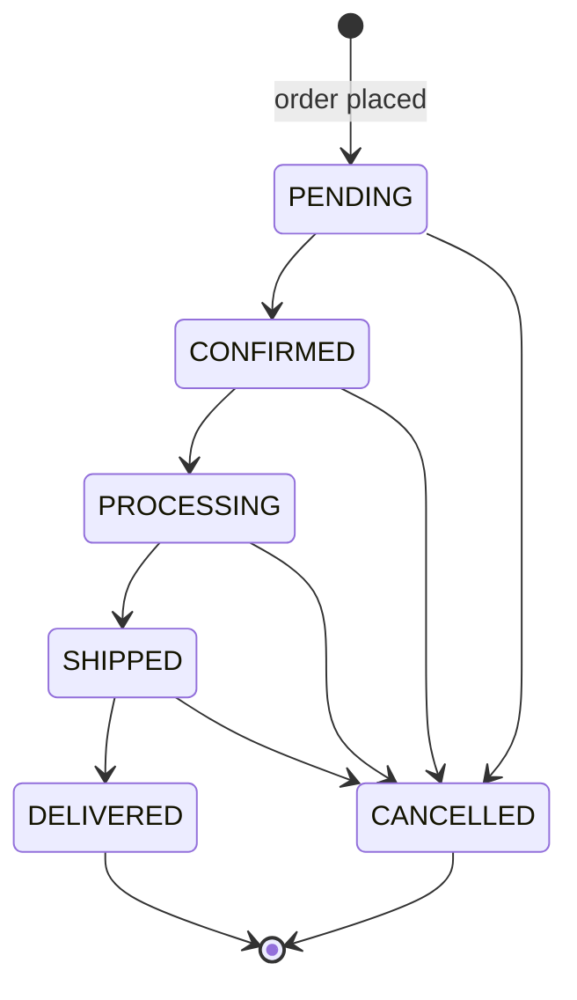

# Data model

PostgreSQL 18, accessed only by the API through Prisma 7 (`prisma-client` generator, ESM output in
`apps/api/src/generated/prisma`) with the `@prisma/adapter-pg` driver adapter. The schema lives in
[`apps/api/prisma/schema.prisma`](../../apps/api/prisma/schema.prisma); migrations in
`apps/api/prisma/migrations`.

## Conventions

| Topic        | Rule                                                                                                                                                                                                  |
| ------------ | ----------------------------------------------------------------------------------------------------------------------------------------------------------------------------------------------------- |
| Primary keys | UUIDv7 (`@default(uuid(7)) @db.Uuid`), generated by Prisma in the API process. Time-ordered (index friendly) and not guessable like serial ids. Translation and join tables use composite keys.       |
| Money        | `NUMERIC(12,2)` plus a `CHAR(3)` ISO-4217 currency column defaulting to `UZS`. Computed with `Prisma.Decimal` (decimal.js), sent over the wire as strings (`^-?\d{1,12}(\.\d{1,2})?$`). Never floats. |
| Quantities   | Integers.                                                                                                                                                                                             |
| Localisation | Translatable text lives in `*Translation` tables keyed by `(entity, locale)`; locales `uz` (default), `ru`, `en`.                                                                                     |
| Snapshots    | Orders copy every purchase-time value they depend on (names, SKUs, prices, delivery method name, address).                                                                                            |
| Timestamps   | `TIMESTAMP(3)` (UTC). Reports convert to `Asia/Tashkent`.                                                                                                                                             |
| Invariants   | Rules Prisma cannot express are `CHECK` constraints written into the migrations (listed below).                                                                                                       |
| Deletion     | Business records are deactivated or archived rather than deleted: products are archived, variants deactivated, orders never deleted.                                                                  |
| Concurrency  | Default `READ COMMITTED` isolation. Races are handled with conditional updates (`UPDATE … WHERE stock >= n`, `WHERE status = <expected>`) and unique constraints, not locks.                          |

Connection settings (`apps/api/src/prisma/prisma.service.ts`): pool size `DATABASE_POOL_MAX`
(default 10), 5 s connect timeout, 30 s idle timeout, 15 s `statement_timeout`,
`application_name=teran-api`.

## Entities

### Identity and access

| Model                | Purpose and key fields                                                                                                                                                                                                                          |
| -------------------- | ----------------------------------------------------------------------------------------------------------------------------------------------------------------------------------------------------------------------------------------------- |
| `User`               | Customers and staff. `email` (unique, stored trimmed and lower-case), Argon2id `passwordHash`, `role` (`CUSTOMER`, `MANAGER`, `ADMIN`), names, E.164 `phone`, preferred `locale`, `isActive`, `failedLoginCount`, `lockedUntil`, `lastLoginAt`. |
| `Session`            | Signed-in sessions. Only the SHA-256 `tokenHash` of the cookie value is stored. `expiresAt` (fixed), `lastSeenAt`, IP and user agent.                                                                                                           |
| `PasswordResetToken` | SHA-256 `tokenHash`, `expiresAt` (60 minutes), `usedAt` (single use).                                                                                                                                                                           |
| `AuditLog`           | Append-only record of staff actions: `action` (e.g. `order.status`, `product.update`, `inventory.adjust`), `entityType`, `entityId`, JSON `metadata`, actor and IP.                                                                             |
| `CustomerAddress`    | A customer's saved delivery addresses (at most 10, one default — partial unique index): label, recipient, E.164 phone, region code, city, address line, landmark. Deleted with the user.                                                        |

### Catalogue

| Model                                  | Purpose and key fields                                                                                                                                                                                                                                                             |
| -------------------------------------- | ---------------------------------------------------------------------------------------------------------------------------------------------------------------------------------------------------------------------------------------------------------------------------------- |
| `Category` / `CategoryTranslation`     | One category per product (`Product.categoryId`, `ON DELETE RESTRICT`: a category in use cannot be deleted). Two levels through `parentId` (`RESTRICT`; a category cannot be its own parent). `slug`, `position`, `isActive`, `illustrationKey`; translations add editorial `body`. |
| `ProductType` / translations           | Kind of product (`key`, e.g. `tea`, `gift-set`) deciding which attributes a product has. `Product.productTypeId` is optional (`RESTRICT`).                                                                                                                                         |
| `AttributeDefinition` / translations   | Typed attribute of a product type: `key` (unique per type), `kind` (`TEXT`, `NUMBER`, `BOOLEAN`, `SELECT`, `MULTI_SELECT`), `unit`, flags `isRequired`, `isFilterable`, `isSearchable`, `isVisible`, `position`.                                                                   |
| `AttributeOption` / translations       | Choice of a `SELECT`/`MULTI_SELECT` attribute (`key` unique per attribute).                                                                                                                                                                                                        |
| `ProductAttributeValue`                | One value of one attribute for one product: `optionId` (one row per chosen option), or `numberValue` (Decimal 14,3), `booleanValue`, `textValue` (localised JSON). Attribute and option `RESTRICT`: values in use protect their definitions.                                       |
| `SlugRedirect`                         | Old slug of a category, product or collection (`entity`, `fromSlug` unique together) → entity id, so renamed addresses keep working.                                                                                                                                               |
| `Collection` / `CollectionTranslation` | Curated groups; many-to-many with products through `ProductCollection` (with `position`).                                                                                                                                                                                          |
| `Product` / `ProductTranslation`       | `slug`, `status` (`DRAFT`, `ACTIVE`, `ARCHIVED`), `format`, `isFeatured`, optional caffeine level and brewing guidance, `publishedAt`, denormalised `minPrice`. Translations hold name, descriptions, ingredients, tasting notes, origin, SEO fields and `searchText`.             |
| `ProductVariant`                       | A purchasable pack size: unique `sku` and optional unique `barcode`, `weightGrams` or `unitCount`, `price`, optional `compareAtPrice`, `currency`, `stockQuantity`, `lowStockThreshold` (default 5), `isActive`, `position`.                                                       |
| `ProductImage`                         | `storageKey` (files at `<UPLOADS_DIR>/<storageKey>/<width>.webp`), available `widths`, intrinsic `width`/`height`, `altText`, `position`.                                                                                                                                          |

A product is **visible** in the storefront when it is `ACTIVE`, `publishedAt <= now()` and has at
least one active variant (`apps/api/src/catalog/product-visibility.ts`). `publishedAt` is set the
first time a product becomes active and kept afterwards. `minPrice` (lowest active variant price)
is recomputed in the same transaction as every product save and is used for sorting and price
filters.

### Carts, delivery and orders

| Model                                          | Purpose and key fields                                                                                                                                                                                                                                                                                                                                                                                |
| ---------------------------------------------- | ----------------------------------------------------------------------------------------------------------------------------------------------------------------------------------------------------------------------------------------------------------------------------------------------------------------------------------------------------------------------------------------------------- |
| `Cart` / `CartItem`                            | One model for guest and customer carts. The cookie holds a random token; only its SHA-256 is stored. `expiresAt` slides on every change. Items are unique per `(cart, variant)`.                                                                                                                                                                                                                      |
| `DeliveryMethod` / `DeliveryMethodTranslation` | Unique `code`, `price`, optional `freeFromAmount` (free delivery threshold; null = never free), `regionCodes` (ISO 3166-2 codes of Uzbekistan; empty = every region), `requiresAddress`. Name, description and estimate are translated.                                                                                                                                                               |
| `Order`                                        | Unique `number` (`TRN-` + 8 characters), `status`, `paymentStatus`, `paymentMethod`, `locale`, optional `userId` (guests have none), customer contact and address snapshot, `subtotal`, `deliveryFee`, `discountTotal`, `total`, unique `idempotencyKey`, `accessTokenHash`, `cancelReason`, lifecycle timestamps.                                                                                    |
| `OrderItem`                                    | Snapshot per line: product name (in the order's language), slug, format, SKU, weight or unit count, `unitPrice`, `quantity`, `lineTotal`; `variantId` is kept for reference (`SET NULL`).                                                                                                                                                                                                             |
| `OrderStatusEvent`                             | History: from/to status, payment status, note, acting staff member.                                                                                                                                                                                                                                                                                                                                   |
| `Payment`                                      | One row per payment attempt: method (`CASH_ON_DELIVERY`, `CLICK`, `PAYME`, `CARD`), `provider` (`CASH`, `DEMO`, `CLICK`, `PAYME`), status (see [payments](payments.md)), amount, currency, `providerReference` (unique per provider), `accessTokenHash` (link secret, unique), `expiresAt`, `failureCode`, `confirmedAt`, `confirmedById`. At most one open attempt per order (partial unique index). |
| `PaymentEvent`                                 | Every status change of an attempt: from/to, `source` (customer, provider, staff, system, demo), `detail`, acting staff member.                                                                                                                                                                                                                                                                        |
| `PaymeTransaction`                             | A Payme Merchant API transaction: Payme's id (unique), attempt, amount in tiyin, Payme and TERAN times in milliseconds, state (1, 2, −1, −2), reason. Payments `RESTRICT`.                                                                                                                                                                                                                            |
| `ClickTransaction`                             | A Click SHOP API payment: integer `prepareId` (answered to Click), `clickTransId` (unique), paydoc id, attempt, amount, state (0, 1, −1), Click's error code.                                                                                                                                                                                                                                         |
| `InventoryMovement`                            | Stock ledger: signed `delta`, `quantityAfter`, `reason`, optional `orderId`, actor and note.                                                                                                                                                                                                                                                                                                          |

### Content, enquiries and settings

| Model                                 | Purpose and key fields                                                                                                                                                    |
| ------------------------------------- | ------------------------------------------------------------------------------------------------------------------------------------------------------------------------- |
| `Article` / `ArticleTranslation`      | Journal. `status` (`DRAFT`, `PUBLISHED`), `publishedAt`; body is plain text with blank-line paragraphs (never rendered as HTML).                                          |
| `SiteSetting`                         | Key/value JSON validated with Zod on write and read. Keys: `announcement` (bar text and link per locale), `contact` (phone, e-mail, Telegram, Instagram, address, hours). |
| `ContactInquiry` / `WholesaleInquiry` | Messages from the contact and wholesale forms, with `status` (`NEW`, `IN_PROGRESS`, `RESOLVED`, `SPAM`), internal note, `handledAt`.                                      |
| `NewsletterSubscriber`                | Unique e-mail, locale, `status` (`SUBSCRIBED`, `UNSUBSCRIBED`), source, dates. Unsubscribe tokens are derived (HMAC), not stored.                                         |

## Database-enforced invariants

All `CHECK` constraints are created in the first migration
(`20261013175434_init/migration.sql`):

| Table                          | Constraint                                                                                                                                                                                       |
| ------------------------------ | ------------------------------------------------------------------------------------------------------------------------------------------------------------------------------------------------ |
| `ProductVariant`               | `price >= 0`; `compareAtPrice IS NULL OR compareAtPrice > price`; `stockQuantity >= 0`; `lowStockThreshold >= 0`; positive `weightGrams` and `unitCount` when set; currency matches `^[A-Z]{3}$` |
| `Product`                      | brewing temperature 40–100 °C; positive brewing time and amount; maximum brewing time ≥ minimum                                                                                                  |
| `CartItem`                     | `quantity BETWEEN 1 AND 99` (the API caps lines at 20 and carts at 30 lines)                                                                                                                     |
| `DeliveryMethod`               | non-negative `price` and `freeFromAmount`; ISO currency                                                                                                                                          |
| `Order`                        | non-negative amounts; `total = subtotal + deliveryFee - discountTotal`; ISO currency                                                                                                             |
| `OrderItem`                    | `quantity > 0`; `unitPrice >= 0`; `lineTotal = unitPrice * quantity`                                                                                                                             |
| `Payment`                      | `amount >= 0`                                                                                                                                                                                    |
| `InventoryMovement`            | `delta <> 0`; `quantityAfter >= 0`                                                                                                                                                               |
| `User`, `NewsletterSubscriber` | `email = lower(btrim(email))`                                                                                                                                                                    |

Added by `20261014150000_accounts_payments_catalogue` and `20261014160000_payment_providers`:

| Table                   | Constraint                                                                                                                                      |
| ----------------------- | ----------------------------------------------------------------------------------------------------------------------------------------------- |
| `Category`              | `parentId IS NULL OR parentId <> id`                                                                                                            |
| `CustomerAddress`       | at most one `isDefault` row per user (partial unique index)                                                                                     |
| `ProductAttributeValue` | exactly one of `optionId`, `numberValue`, `booleanValue`, `textValue` is set; one scalar value per product and attribute (partial unique index) |
| `Payment`               | at most one attempt in `PENDING`, `REQUIRES_ACTION` or `PROCESSING` per order (partial unique index)                                            |

The `pg_trgm` extension backs a GIN trigram index on `ProductTranslation.searchText`.

## Money

- Line totals, subtotals and order totals are exact decimal arithmetic; nothing is rounded
  (Uzbek sum prices are whole numbers in practice, but two decimals are stored).
- **Delivery fee:** the method's `price`, or `0` when `freeFromAmount` is set and the subtotal
  reaches it (`apps/api/src/delivery/delivery.service.ts`).
- `discountTotal` is always `0`; discounts are not implemented.
- The client never supplies a price. At checkout every unit price is read from the variant row
  inside the order transaction.

## Order lifecycle

The transition table (`ORDER_STATUS_TRANSITIONS`, `canTransitionOrder`) lives in
`packages/contracts/src/orders.ts` and is shared by the API and the admin UI.

- Staff change status with a conditional update on the status they saw; a concurrent change
  returns `409 CONFLICT`, an illegal transition `409 INVALID_STATUS_TRANSITION`.
- `CONFIRMED`, `SHIPPED`, `DELIVERED` and `CANCELLED` set `confirmedAt`, `shippedAt`,
  `deliveredAt` and `cancelledAt`.
- **Cancelling** requires a reason, cancels a still-pending payment, and returns every line's
  quantity to stock with an `ORDER_CANCELLED` ledger entry. A paid order keeps its `PAID` status;
  refunds are not implemented.
- Every change writes an `OrderStatusEvent` and an `AuditLog` row in the same transaction.

### Placing an order

One transaction (`apps/api/src/orders/orders.service.ts`, 15 s timeout):

1. Reject payment methods not listed in `PAYMENT_METHODS_ENABLED` (`CASH_ON_DELIVERY` only).
2. **Idempotency:** if an order with the client's `idempotencyKey` (a UUID the checkout page
   creates once per visit) exists, return it unchanged. A concurrent duplicate that hits the
   unique index re-reads and returns the winning order.
3. Re-read the cart. Empty → `400 CART_EMPTY`; unavailable lines → `409 CART_ITEM_UNAVAILABLE`.
4. Reserve stock per line with `UPDATE … SET stockQuantity = stockQuantity - n WHERE id = … AND
isActive AND stockQuantity >= n`; no row → `409 INSUFFICIENT_STOCK`. Stock can never go
   negative or be oversold (also enforced by the `CHECK`).
5. Quote delivery for the region; unavailable method → `422 DELIVERY_METHOD_UNAVAILABLE`.
6. If the client sent the total it displayed and the server total differs, roll back with
   `409 PRICE_CHANGED` (the checkout page re-quotes and asks the customer to confirm).
7. Insert the order, its lines, the first status event, a `PENDING` payment and `ORDER_PLACED`
   ledger entries, then empty the cart.

The order number is `TRN-` plus 8 characters from Crockford's base-32 alphabet, generated with
`crypto.randomInt`; a collision retries the transaction (up to 3 times).

**Guest access:** the order-status link carries a token
`HMAC-SHA256(APP_SECRET, "order-access:" + idempotencyKey)`. Only its SHA-256 is stored, so
the link can be re-issued on an idempotent replay without storing the raw token. Lookups compare
in constant time and return the same 404 for an unknown order and a wrong token.

## Inventory

- Stock lives on `ProductVariant.stockQuantity`; every change is mirrored by an
  `InventoryMovement` row with the resulting `quantityAfter`.
- Reasons: `INITIAL_STOCK` (new variant), `ORDER_PLACED`, `ORDER_CANCELLED`, and the manual
  reasons `RESTOCK`, `MANUAL_ADJUSTMENT` and `RETURN` (admin Inventory page).
- Manual decreases use a conditional update, so stock cannot go below zero
  (`409 INSUFFICIENT_STOCK`); ledger row and audit entry are written in the same transaction.
- Editing a product never changes stock. Variants removed from a product are deactivated, so
  their history and order references stay intact.
- Availability shown to shoppers: `out_of_stock` at 0, `low_stock` at or below
  `lowStockThreshold`, otherwise `in_stock`. Carts do not reserve stock.

## Payments

An order has one or more payment attempts; `Order.paymentStatus` mirrors the latest. Cash on
delivery starts `PENDING` and only staff can record the cash (conditional update, `confirmedAt`,
`confirmedById`, a payment event, an order status event and an audit entry); delivering an order
does not mark it paid. Online attempts (Click, Payme, or the demo provider) are paid only by an
authenticated provider confirmation and expire with the order's payment window, after which the
order is cancelled and its stock returned. No code path sets `PAID` from a customer's request. The
lifecycle, providers and safeguards are described in [payments](payments.md).

## Carts and sessions

- **Cart cookie** `teran_cart` (`__Host-teran_cart` when `COOKIE_SECURE=true`): HttpOnly,
  `SameSite=Lax`, 32 random bytes. TTL `CART_TTL_DAYS` (default 30), extended on every change.
- **Ownership:** a guest cart is usable by whoever holds its cookie; a cart attached to an account
  only by that account's session.
- **On sign-in or registration** a guest (or the customer's own) cart on the device is attached to
  the account and merged with the account's most recent other cart in one transaction (quantities
  summed, capped at stock and 20 per line, at most 30 lines, device lines first); a cart belonging
  to another account is never attached. Rules: [cart and account](cart-and-account.md).
- **Session cookie** `teran_session` (`__Host-teran_session` in production): 256-bit token,
  SHA-256 stored, fixed lifetime of `SESSION_TTL_DAYS` (customers, default 30) or
  `STAFF_SESSION_TTL_HOURS` (staff, default 12). Role and `isActive` are read on every request.
  All sessions of a user are deleted on password change, password reset and staff deactivation.
- **Clean-up:** every API process deletes expired sessions, expired carts (with their lines) and
  used or expired reset tokens a minute after start-up and then hourly
  (`apps/api/src/maintenance/maintenance.service.ts`).

## Translations

`uz` is required for every translated entity in the admin; `ru` and `en` are optional. Reads load
the requested locale and `uz`, prefer the requested one and fall back to `uz`
(`apps/api/src/common/i18n.ts`); saving without a locale deletes that locale's row.

## Search

`ProductTranslation.searchText` is a normalised (NFC, lower-case, unified apostrophes, collapsed
whitespace) concatenation of name, descriptions, ingredients, tasting notes and origin, rebuilt
on every save (`apps/api/src/catalog/product-search.ts`). Queries match
`searchText LIKE '%term%'` in the requested locale and `uz`, served by the trigram index. There is
no relevance ranking; results use the chosen sort order.

## Migrations

| Migration                                             | Change                                                                                                                                                                     |
| ----------------------------------------------------- | -------------------------------------------------------------------------------------------------------------------------------------------------------------------------- |
| `20261013175434_init`                                 | `pg_trgm`, all tables, enums, indexes, foreign keys and `CHECK` constraints                                                                                                |
| `20261013181656_product_min_price`                    | `Product.minPrice` and its index                                                                                                                                           |
| `20261013184641_order_item_format`                    | `OrderItem.format` snapshot                                                                                                                                                |
| `20261013201614_newsletter_derived_unsubscribe_token` | Drops the stored unsubscribe token hash (tokens are now derived with HMAC)                                                                                                 |
| `20261014150000_accounts_payments_catalogue`          | Addresses; category tree and editorial text; product types, attributes, values; slug redirects; payment statuses, methods, providers, attempt fields and events (additive) |
| `20261014160000_payment_providers`                    | Payme and Click transactions; unique payment link secret; one open attempt per order (additive)                                                                            |

Rules: create migrations with `pnpm db:migrate` during development; deploy with
`prisma migrate deploy` (the `migrate` job in production, the global setup in integration tests);
never edit an applied migration; never reset a database that is not a disposable `_test`/`_e2e`
database.

## Demonstration seed

`pnpm db:seed` (`apps/api/prisma/seed/index.ts`, catalogue in `catalogue.ts`) loads 7 categories
(Tea with five tea types, and Gift sets), 2 product types (tea, gift set) with demonstration
attribute values, 4 collections, 21 products (one a draft) with 32 variants, 2 delivery methods, the `announcement`
and empty `contact` settings and 6 journal articles (one a draft). `pnpm db:seed:demo` adds the
activity in `activity.ts`: 8 customers who cannot sign in, 24 `TRN-DEMO` orders with items,
status events, payments and ledger entries, 11 enquiries and 10 newsletter subscribers.

Both are idempotent and insert-only (every record is matched by slug, code, order number, e-mail
or company and skipped if present), refuse `NODE_ENV=production` unless `ALLOW_DEMO_SEED=true`,
and draw product images in code (SVG rendered with sharp, stored as WebP). `pnpm db:demo:reset`
removes exactly the demonstration records and reloads them; it never runs in production and needs
`--confirm=<database>` (`guard.ts`, unit tested). All of it is placeholder data: see
[demo mode](../development/demo-mode.md) and
[business information required](../business-information-required.md).

## Known limitations

- No discounts. Refunds are recorded (Payme automatically, cash and Click by staff); partial
  refunds are modelled but not offered in the admin.
- Click and Payme are implemented to their documentation but not yet run against the providers;
  fiscal receipts are not implemented ([payments](payments.md)).
- An idempotent replay returns the original order without comparing the new request body.
- Foreign keys `Order.deliveryMethodId`, `OrderStatusEvent.actorUserId`, `Payment.confirmedById`
  and `InventoryMovement.actorUserId` are not indexed; they are only used for joins from the
  indexed side today.
