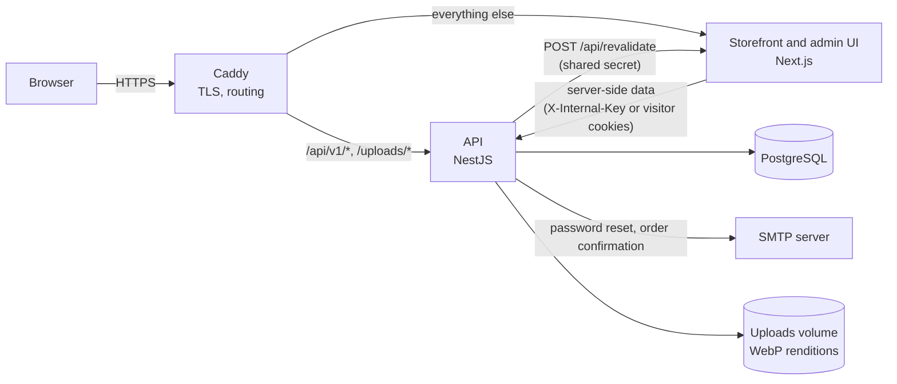
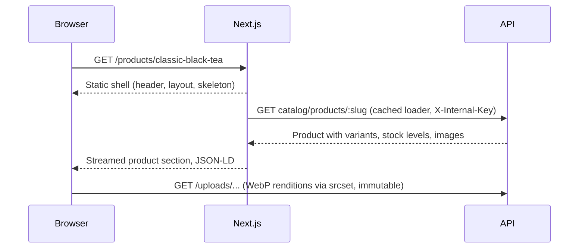
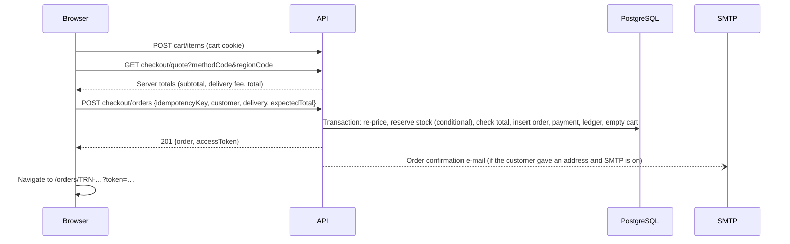
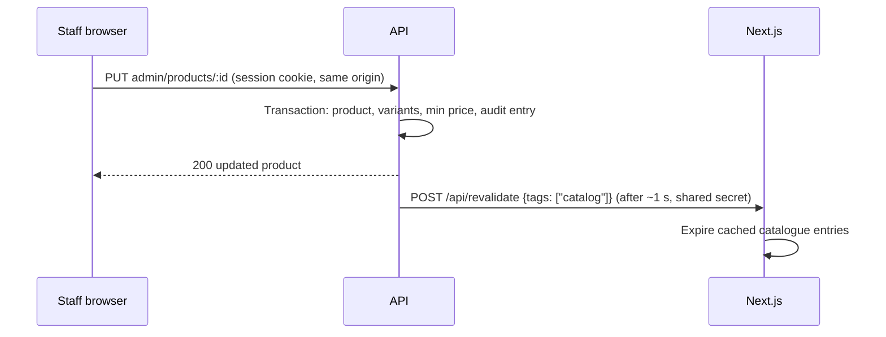

# Architecture overview

TERAN is a storefront and administration area for TERAN® — Premium Chinese Tea, a brand of TERAN
TRADE MChJ in Namangan, Uzbekistan: catalogue,
bag, cash-on-delivery checkout, customer accounts, enquiries, journal, and a staff area for
products, stock, orders, customers, content and settings. Uzbek is the default language, with
Russian and English.



In development there is no Caddy: the browser talks to Next.js, which rewrites `/api/v1/*` and
`/uploads/*` to the API, so cookies stay first-party either way.

## Repository layout

```
apps/
  api/            NestJS API, Prisma schema, migrations, seed, admin CLI, Dockerfile
  web/            Next.js storefront and admin UI, messages (uz/ru/en), content modules, Dockerfile
packages/
  contracts/      Zod schemas and types shared by API and web (requests, responses, errors, rules)
e2e/              Playwright end-to-end suite and the scripts that build and seed its stack
docker/           Caddyfile, production env example, Postgres init script
docs/             Architecture, design, development, deployment and testing documentation
docker-compose.yml        Local PostgreSQL
docker-compose.prod.yml   Production stack
.github/workflows/ci.yml  Continuous integration (never deploys)
```

Key decisions are recorded in [decisions.md](./decisions.md); the data model in
[database.md](./database.md); security controls in [security.md](./security.md).

## Storefront and admin UI (`apps/web`)

Next.js 16 App Router with React 19, TypeScript in strict mode, Tailwind CSS v4 and next-intl.

### Routes

| Area    | Routes                                                                                                                                                                                                                                                                                                                 |
| ------- | ---------------------------------------------------------------------------------------------------------------------------------------------------------------------------------------------------------------------------------------------------------------------------------------------------------------------- |
| Shop    | `/`, `/catalog` (all products), `/[category]` and `/[category]/[subcategory]` (e.g. `/tea/green-tea`; `/catalog/[category]` redirects), `/collections/[collection]`, `/products/[slug]`, `/search`, `/cart`, `/checkout`, `/orders/[number]` (guest status link), `/payments/demo/[token]`, `/payments/return/[token]` |
| Account | `/account`, `/account/orders`, `/account/orders/[number]`, `/account/purchases`, `/account/addresses`, `/account/profile`, `/account/security`, `/account/login`, `/account/register`, `/account/forgot-password`, `/account/reset-password`                                                                           |
| Content | `/about`, `/wholesale`, `/journal`, `/journal/[slug]`, `/contact`, `/faq`, `/delivery`, `/returns`, `/privacy`, `/terms`, `/newsletter/unsubscribe`                                                                                                                                                                    |
| Admin   | `/admin` (dashboard), `orders`, `products` (+ new, edit), `categories`, `product-types`, `collections`, `inventory`, `customers`, `inquiries`, `newsletter`, `journal`, `delivery`, `settings`, `staff`, `audit`                                                                                                       |
| System  | `/api/health`, `/api/revalidate`, `/sitemap.xml`, `/robots.txt`, `/manifest.webmanifest`, icons, branded 404 and error pages                                                                                                                                                                                           |

Every page exists in each enabled language: Uzbek without a prefix, `/ru/...` and `/en/...`
([ADR-007](./decisions.md)).

### Rendering and data

- **Static shell, streamed data.** With Cache Components and partial prerendering, each page's
  shell (header, headings, skeletons) is prerendered; catalogue, content and account data stream
  into `Suspense` boundaries. Data regions call `connection()`, so builds never fetch API data
  ([ADR-008](./decisions.md)).
- **Cached loaders** (`apps/web/src/lib/data`): categories, collections, product lists and details,
  related products, sitemap entries, settings, articles and checkout options use `'use cache'`
  with tags `catalog`, `content` and `settings`. The API calls `POST /api/revalidate` after
  changes; the route verifies the shared secret and expires the tags.
- **API access** (`apps/web/src/lib/api`): `server.ts` (server-only) sends cached requests with
  `X-Internal-Key` and visitor requests with the visitor's cookies and `X-Forwarded-For`
  ([ADR-011](./decisions.md)); `client.ts` calls `/api/v1` from the browser on the same origin.
- **Client state** is limited to the bag (a small external store kept in sync with the API) and
  form state. There is no global client data cache.
- **Forms** validate with the same Zod contracts as the API, show field errors from either side,
  translate messages from shared keys, and move focus to the first problem.

### SEO

Per-page titles and descriptions, canonical URLs, `hreflang` alternates with `x-default`, Open
Graph images, a sitemap of every public page per language, and JSON-LD: `Organization` and
`WebSite` (home), `BreadcrumbList`, `Product` with offers per pack size (no ratings), `Article`,
and `FAQPage`. Private pages are `noindex` and disallowed in `robots.txt`. In demonstration mode
the whole site is `noindex` ([ADR-012](./decisions.md)).

Pages whose metadata depends on data stream it after the shell for browsers and for crawlers
that render JavaScript (Googlebot). Crawlers and link-preview bots that read only HTML — Yandex,
Bing, Apple, Facebook, Telegram, WhatsApp and others in Next.js's `htmlLimitedBots` list — get
every tag in `<head>`.

### Admin UI

Lives in the same application under `/admin` with its own layout: a server-side gate (`/auth/me`)
redirects visitors to sign-in and shows customers a "staff only" page; administrator-only sections
are hidden from managers. The API enforces every rule independently. Admin pages show loading
skeletons while data loads, and an error boundary keeps the navigation available if a page fails.

## API (`apps/api`)

NestJS 12 (ESM) under `/api/v1`, Prisma 7 with the `pg` driver adapter.

### Request pipeline

1. Helmet security headers (strict CSP for JSON), CORS for the configured origins, cookie parsing.
2. JSON body parsing only, 100 kB limit.
3. Origin check for state-changing requests (CSRF protection).
4. Static `/uploads/*` (immutable product images).
5. Session middleware: resolves the session cookie to `request.auth`.
6. Global guards: rate limiting, then authorisation (`@RequireAuth`, `@RequireStaff`).
7. Global validation pipe: every body, query and parameter parsed with the shared Zod schemas.
8. Controller and service; Prisma transactions where several writes must succeed together.
9. Global exception filter: one error shape, generic messages for server errors.

### Modules

| Module      | Responsibility                                                                                                                                                                                       |
| ----------- | ---------------------------------------------------------------------------------------------------------------------------------------------------------------------------------------------------- |
| Config      | Validates the environment once at start-up; production rules fail closed                                                                                                                             |
| Core        | Audit log, mail, storefront revalidation, sessions                                                                                                                                                   |
| Health      | Liveness and readiness (database) probes                                                                                                                                                             |
| Catalog     | Public category tree and category pages, collections, product list with attribute filters and facets, search, suggestions, detail with characteristics, related products, slug redirects, sitemap    |
| Content     | Public settings (announcement, contact) and journal articles                                                                                                                                         |
| Orders      | Bag, delivery pricing, checkout quote and order placement, guest and account order lookups                                                                                                           |
| Payments    | Payment attempts and their state machine, demo provider, Payme and Click callbacks, payment window expiry ([payments](payments.md))                                                                  |
| Account     | Customer overview, filtered orders, purchases, reorder, address book, e-mail change, signed-in devices ([cart and account](cart-and-account.md))                                                     |
| Auth        | Registration, sign-in and out, profile, password change, forgotten-password flow                                                                                                                     |
| Inquiries   | Contact and wholesale enquiries, newsletter subscribe and unsubscribe                                                                                                                                |
| Admin       | Staff API: dashboard and reports, products and images, categories, collections, stock, orders and payments, customers, staff, enquiries, newsletter, settings, delivery methods, articles, audit log |
| Maintenance | Hourly clean-up of expired sessions, carts and reset tokens                                                                                                                                          |

### Endpoints

All paths are prefixed with `/api/v1`. "Staff" means `MANAGER` or `ADMIN`. OpenAPI documentation
is served at `/api/docs` when `SWAGGER_ENABLED=true` (development).

| Area       | Endpoints                                                                                                                                                                                                                                                                                                                                                                                                                                                                                                                                                                                                                                        | Access                 |
| ---------- | ------------------------------------------------------------------------------------------------------------------------------------------------------------------------------------------------------------------------------------------------------------------------------------------------------------------------------------------------------------------------------------------------------------------------------------------------------------------------------------------------------------------------------------------------------------------------------------------------------------------------------------------------ | ---------------------- |
| Health     | `GET health/live`, `GET health/ready`                                                                                                                                                                                                                                                                                                                                                                                                                                                                                                                                                                                                            | public                 |
| Catalogue  | `GET catalog/categories`, `catalog/category-page?path=`, `catalog/collections`, `catalog/products` (with `attr.<key>` filters), `catalog/products/:slug`, `catalog/products/:slug/related`, `catalog/redirects/{products,collections}/:slug`, `catalog/search/suggest`, `catalog/sitemap`                                                                                                                                                                                                                                                                                                                                                        | public                 |
| Content    | `GET content/settings`, `content/articles`, `content/articles/:slug`                                                                                                                                                                                                                                                                                                                                                                                                                                                                                                                                                                             | public                 |
| Bag        | `GET cart`, `POST cart/items`, `PATCH cart/items/:itemId`, `DELETE cart/items/:itemId`                                                                                                                                                                                                                                                                                                                                                                                                                                                                                                                                                           | cart cookie            |
| Checkout   | `GET checkout/options`, `GET checkout/quote`, `POST checkout/orders`                                                                                                                                                                                                                                                                                                                                                                                                                                                                                                                                                                             | public                 |
| Orders     | `GET orders/:number?token=` (guest link); `POST orders/:number/payments` (start or retry an online payment: owner or token); `GET account/orders/:number`                                                                                                                                                                                                                                                                                                                                                                                                                                                                                        | token / customer       |
| Payments   | `GET payments/return?token=`, `GET`/`POST payments/demo` (demo mode only); provider callbacks `POST payments/payme` (Basic auth), `POST payments/click/prepare`, `POST payments/click/complete` (signed)                                                                                                                                                                                                                                                                                                                                                                                                                                         | link secret / provider |
| Account    | `GET account/summary`, `GET account/orders?status=&page=`, `POST account/orders/:number/reorder`, `GET account/purchases`, `GET account/profile`, `POST account/email`, `GET account/sessions`, `POST account/sessions/revoke-others`, addresses (`GET`/`POST account/addresses`, `PUT`/`DELETE account/addresses/:id`, `POST account/addresses/:id/default`)                                                                                                                                                                                                                                                                                    | customer               |
| Auth       | `GET auth/features`, `POST auth/register`, `POST auth/login`, `POST auth/logout`, `GET`/`PATCH auth/me`, `POST auth/password/change`, `POST auth/password/forgot`, `POST auth/password/reset`                                                                                                                                                                                                                                                                                                                                                                                                                                                    | public / signed in     |
| Enquiries  | `POST inquiries/contact`, `POST inquiries/wholesale`, `POST newsletter/subscribe`, `POST newsletter/unsubscribe`                                                                                                                                                                                                                                                                                                                                                                                                                                                                                                                                 | public                 |
| Admin      | `GET admin/dashboard`; products (`GET`/`POST admin/products`, `GET`/`PUT admin/products/:id`, images upload, reorder, delete); categories and collections (CRUD, category parent and redirects); product types (`GET`/`POST admin/product-types`, `PUT`/`DELETE admin/product-types/:id`); `GET admin/inventory`, adjustments and movements; `GET admin/orders`, `GET admin/orders/:number`, `POST …/status`, `POST …/payments` (cash), `POST …/refunds`; `GET admin/customers`, `GET admin/customers/:id`; enquiries and newsletter lists and updates; `GET admin/settings`; `GET admin/delivery-methods`; articles (list, get, create, update) | staff                  |
| Admin only | `GET admin/reports/orders.csv`, `GET admin/audit`, `GET admin/newsletter/export.csv`, staff (`GET`/`POST admin/staff`, `PATCH admin/staff/:id`), `PUT admin/settings/announcement`, `PUT admin/settings/contact`, `POST`/`PUT admin/delivery-methods`                                                                                                                                                                                                                                                                                                                                                                                            | `ADMIN`                |

### Errors

Every error has the shape `{ statusCode, code, message, issues?, details?, requestId }`. Codes are
listed in `packages/contracts/src/errors.ts`; the important ones for clients:
`VALIDATION_FAILED` (with field `issues`), `UNAUTHENTICATED`, `FORBIDDEN`, `NOT_FOUND`,
`CONFLICT`, `RATE_LIMITED`, `INVALID_ORIGIN`, `INVALID_CREDENTIALS`, `EMAIL_TAKEN`,
`INVALID_TOKEN`, `FEATURE_DISABLED`, `CART_EMPTY`, `CART_ITEM_UNAVAILABLE`,
`INSUFFICIENT_STOCK`, `PRICE_CHANGED`, `DELIVERY_METHOD_UNAVAILABLE`,
`INVALID_STATUS_TRANSITION`, `PAYLOAD_TOO_LARGE`, `UNSUPPORTED_MEDIA_TYPE`, `INTERNAL_ERROR`.
The storefront translates them into the visitor's language.

### E-mail

Two plain-text messages in the customer's language: password reset and order confirmation (with
the order-status link). The transport is `disabled` (default), `log` (development only) or `smtp`.
Without SMTP, password reset is switched off and orders are still confirmed on screen.

## Main flows

### Browsing a product page



### Checkout



A retry with the same idempotency key returns the same order; a total the customer did not see
returns `409 PRICE_CHANGED` and the page asks them to confirm the new total.

### Staff change reaching the storefront



## Configuration

Each application validates its own environment; examples with placeholders only are committed:
`apps/api/.env.example`, `apps/web/.env.example` and `docker/production.env.example`. See
[local development](../development/setup.md) and [production deployment](../deployment/production.md).

## Observability

- Structured JSON logs (pino) with a request id that is also returned in `X-Request-Id` and in
  error bodies, so a customer-visible error can be traced to its log line.
- Health endpoints for liveness and database readiness; container health checks use them.
- Audit log of every staff action, readable by administrators in the admin area.

## Limits of the current design

- One API and one web instance. Rate-limit counters and the Next.js cache are in process memory,
  and uploads are on a local volume; running several instances needs shared stores.
- No online payments, discounts or refunds yet; cash on delivery only.
- Search is substring matching on normalised text (trigram index), without relevance ranking.
